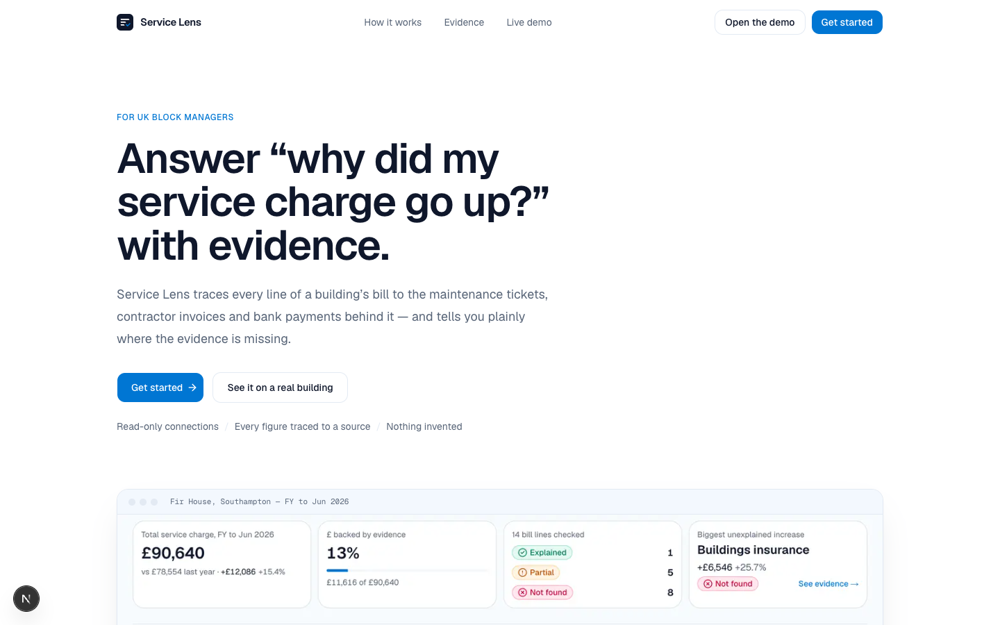
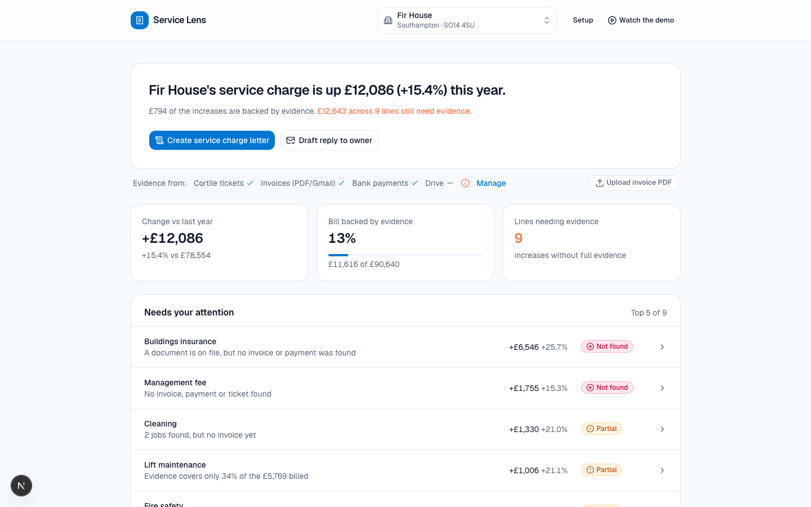
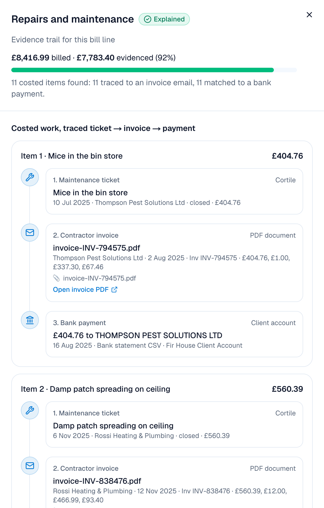
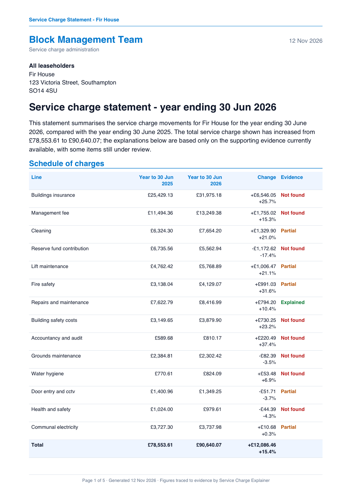
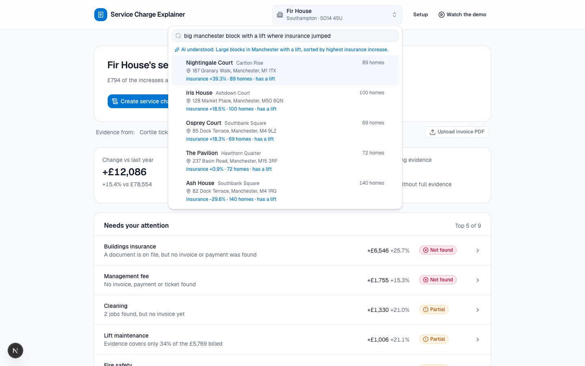
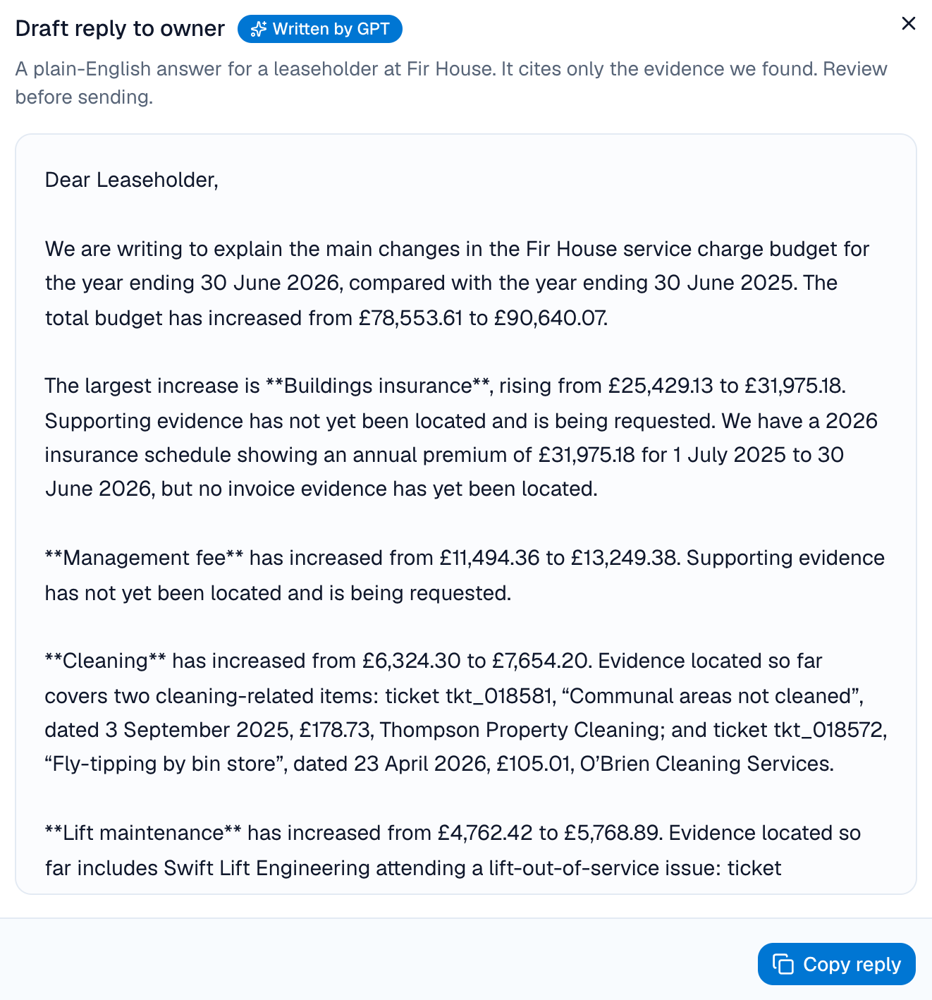
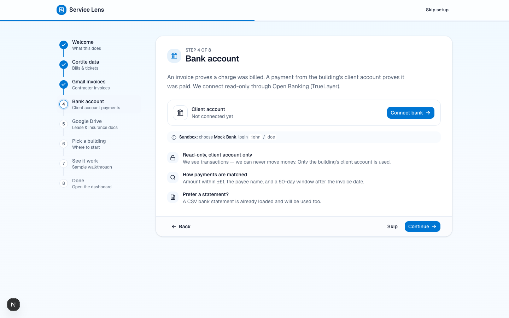
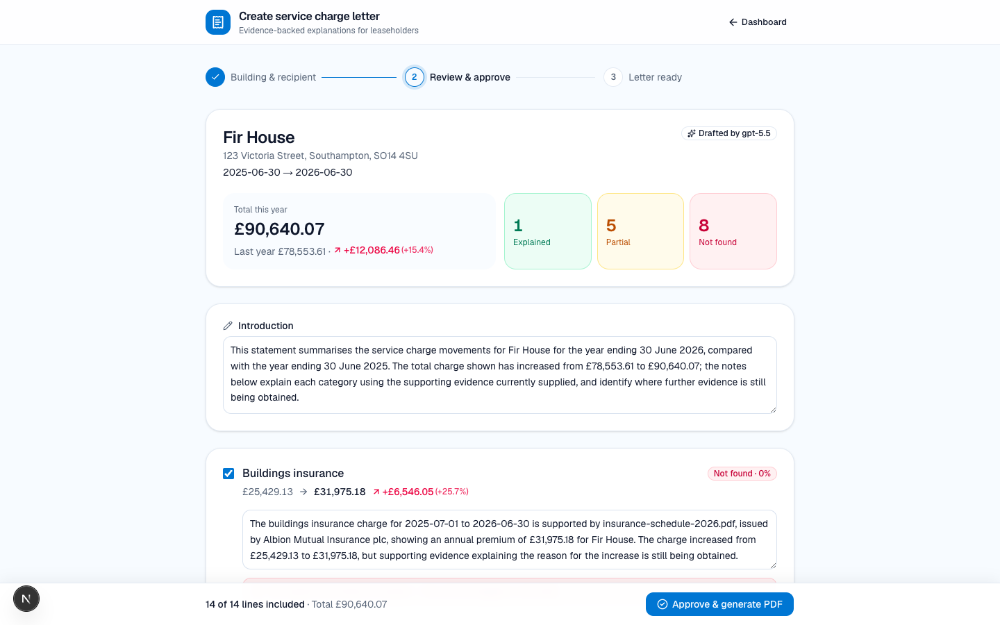
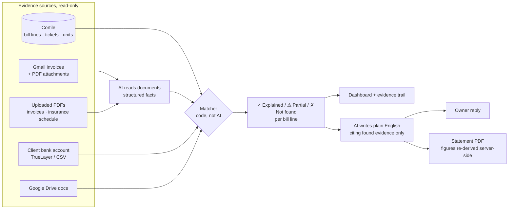

# Service Lens

**Answer "why did my service charge go up?" with evidence, not guesswork.**

Service Lens is for UK block managers. It traces every line of a building's
service-charge bill to the evidence behind it: maintenance tickets, contractor invoices,
payments from the client bank account and documents. It shows clearly where evidence
is missing. It then writes the reply to the leaseholder, or issues a full service-charge
statement PDF, citing only what it found.

> Built in one evening at the Real Estate GB hackathon (November 2026).



---

## Why

- **4.9 million** leasehold homes in England, about 20% of the housing stock
  ([MHCLG, 2024–25](https://www.gov.uk/government/statistics/leasehold-dwellings-2024-to-2025/leasehold-dwellings-2024-to-2025)).
- Every leaseholder can challenge their service charge. One block manager typically looks
  after **hundreds of units** ([example](https://www.flat-living.co.uk/?p=9689)) on a salary of
  about **£40k** ([Jooble](https://uk.jooble.org/salary/block-manager)).
- The evidence for any increase is spread across four systems: the property-management
  system, someone's inbox, the client bank account and a shared drive. Putting it together
  by hand takes days per building.

## What it does

| | |
|---|---|
| **Verdict first** | "Fir House's service charge is up £12,086 (+15.4%). £794 of the increases are backed by evidence; £12,643 across 9 lines still needs evidence." |
| **Every line gets a status** | **✓ Explained**: matched evidence covers at least 80% of the £. **⚠ Partial**: some evidence. **✗ Not found**: nothing matched. It never invents evidence. |
| **Evidence trail** | Ticket → contractor invoice → bank payment, with a link to each source document. |
| **Draft reply to owner** | A plain-English letter that cites only invoice numbers, tickets, payments and documents that were found. |
| **Service-charge statement PDF** | Pick a building or a flat, review and approve each line and its explanation, then download a multi-page statement with schedule of charges, the flat's share, the reasoning for each line and an evidence appendix. |
| **AI building search** | "Big Manchester block with a lift where insurance jumped" finds Nightingale Court (insurance +39.3%, 89 homes, lift). |
| **Upload real documents** | Drop in invoice PDFs; they are read by AI and matched straight away. |



<table>
<tr>
<td width="50%"><br><sub>Evidence trail: ticket → invoice PDF → bank payment</sub></td>
<td width="50%"><br><sub>Generated service-charge statement (page 1 of 5)</sub></td>
</tr>
<tr>
<td><br><sub>Describe a building in plain English</sub></td>
<td><br><sub>Reply to the owner, citing only found evidence</sub></td>
</tr>
<tr>
<td><br><sub>Onboarding: connect Cortile, Gmail, the client bank account and Drive (read-only)</sub></td>
<td><br><sub>Review and approve each line before the statement is issued</sub></td>
</tr>
</table>

## How it works



**The AI never does the maths.** It only reads documents and writes text. All matching
and all figures are computed in code:

| Step | Rule |
|---|---|
| Bill line ↔ tickets | Same building, mapped category (e.g. `lift_breakdown` → lift maintenance) and financial year |
| Ticket ↔ invoice | Invoice references the ticket, or the amount is within £1 and the contractor matches |
| Invoice ↔ payment | Amount within £1, payee matches the contractor, paid within 60 days, and from the **building's client account only** |
| Coverage | Sum of matched, costed evidence ÷ billed amount (≥ 80% = Explained) |
| Statement PDF | The server re-runs the matcher; the browser can only change text and which lines are included, never the money |

AI uses OpenAI (`gpt-5.5` by default, configurable). It extracts the supplier, invoice
number, date, total, ticket reference and broker commission disclosure from each PDF or
email. Each document is cached by content hash, so it's only paid for once.

## Pages

| Route | |
|---|---|
| `/` | Landing page with sourced market figures and a hire-vs-tool ROI calculator |
| `/onboarding` | Step-by-step setup: Cortile → Gmail (+ Drive) → bank → pick a building → sample walkthrough |
| `/app` | Dashboard: verdict, "needs your attention", evidence trail, draft reply, guided demo tour |
| `/letters` | Create a service-charge statement PDF for a building or a single flat |

## Run it locally

```bash
pnpm install
cp .env.example .env.local     # add the keys you have
pnpm dev                       # http://localhost:3000
```

1. **Data:** put the Cortile hackathon database at `data/cortile-hackathon.sqlite`.
   It isn't committed; `data/` is git-ignored.
2. **Demo evidence pack (optional):** `node scripts/make-demo-pack.mjs` generates contractor
   invoice PDFs, an insurance schedule and a client-account bank statement CSV for
   Fir House (`bld_0853`) from its real ticket data. These are demo files, labelled as such.
3. **Keys** in `.env.local`:

| Variable | Used for |
|---|---|
| `OPENAI_API_KEY`, `OPENAI_MODEL` | Reading documents, writing replies and statements, building search |
| `GOOGLE_CLIENT_ID`, `GOOGLE_CLIENT_SECRET` | Gmail + Drive (read-only OAuth) |
| `TRUELAYER_ENV`, `TRUELAYER_SANDBOX_*`, `TRUELAYER_LIVE_*` | Client bank account via Open Banking (sandbox: Mock Bank, `john` / `doe`) |
| `SESSION_SECRET` | Encrypting session cookies (`openssl rand -base64 32`) |

Without an OpenAI key, the app falls back to a regex PDF reader and template text.

## Stack

Next.js 16 (App Router) · TypeScript · Tailwind CSS v4 · shadcn/ui · motion ·
`node:sqlite` · pdf-lib (PDF generation) · unpdf (PDF text) · OpenAI · Gmail/Drive APIs · TrueLayer Data API

```
src/
  app/            pages + API routes (explain, letters, buildings/search, auth, docs upload)
  lib/
    matcher.ts    evidence matching + coverage (code only)
    ai.ts         OpenAI: document extraction, building-query parsing, text writing
    letters.ts    statement drafting + PDF generation
    cortile.ts    read-only data layer over the Cortile SQLite file
  components/     landing, onboarding, explainer (dashboard), letters
```

## Principles

- **Never invent evidence.** If nothing matches, the line says "Not found", in the UI and in every letter.
- **Code does the maths, AI does the reading and writing.**
- **Read-only connections**, and only the building's client account is used for payments.
- **No secrets in the repo.** Keys live in `.env.local`, which is git-ignored.
